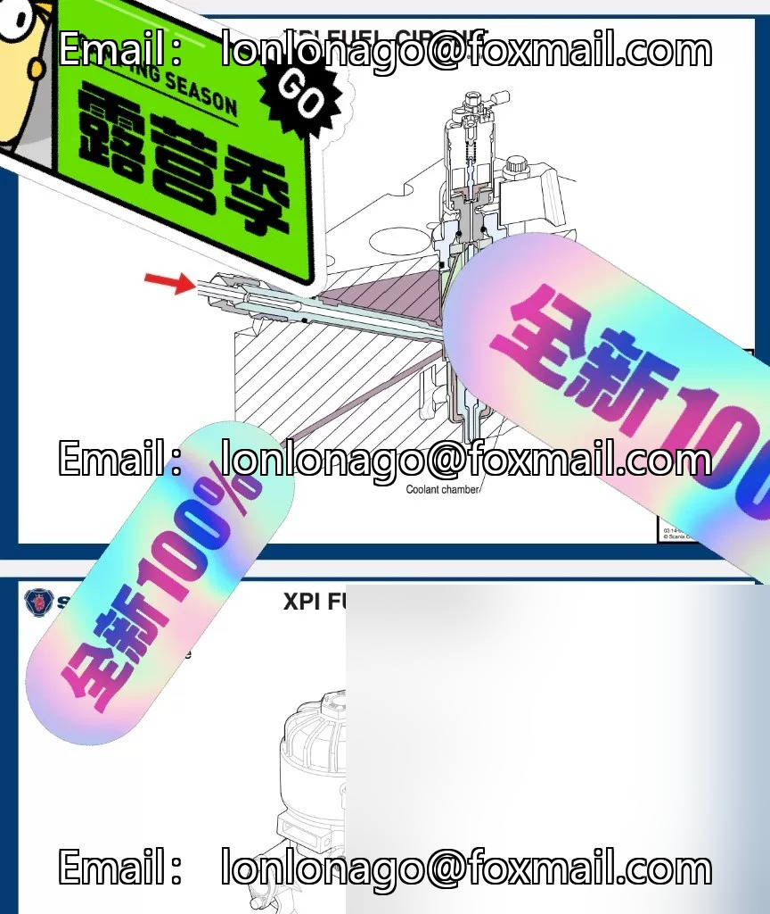
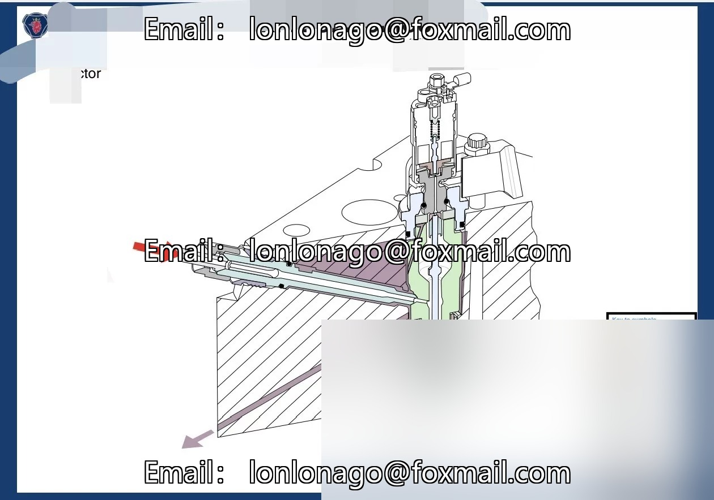

# SCANIA 16L engine XPI ultra-high pressure injection fuel system for welding

## Body

SCANIA 16-liter engine XPI ultra-high-pressure fuel injection system working principle illustrated, 11-page high-definition PDF.
The XPI system is the ring injector fuel injection technology developed by SCANIA, with high injection pressure, enhancing combustion efficiency, reducing emissions, and improving power output.
non-refundable upon sale.
The XPI system is an advanced ring injector fuel injection technology developed by SCANIA, with extremely high injection pressure (usually reaching 2000 bar or even above 2400 bar), primarily used to enhance combustion efficiency, reduce emissions, and improve the engine's power output.
499694452

The materials cover the SCANIA 16-litre engine XPI super-high-pressure injection fuel system, including a working principle diagram and an 11-page high-resolution PDF, along with features of its common rail injection technology.

<!-- AI_ENRICHED -->

## Images

## Payment

Here is a pay link on Stripe ( https://buy.stripe.com/3cs8yP7sY87d0vu9AB ). Please contact me lonlonago@foxmail.com after funding $89, and I will send you a complete data files , thank you!

